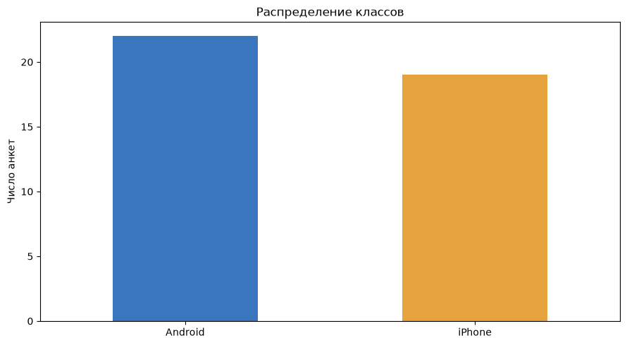
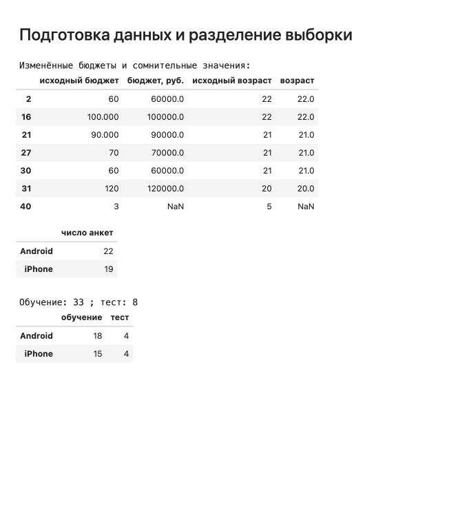
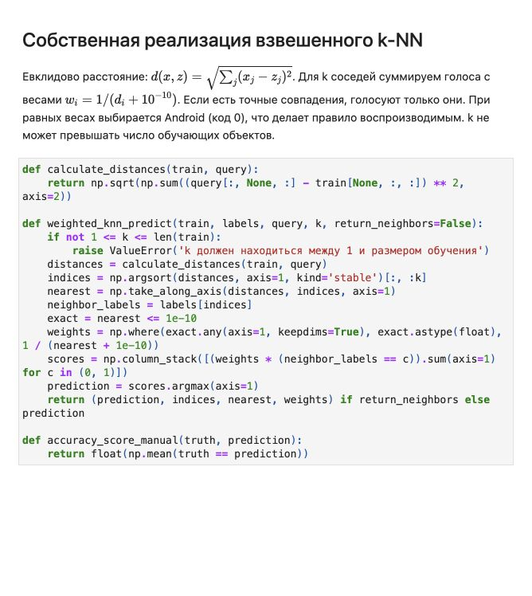
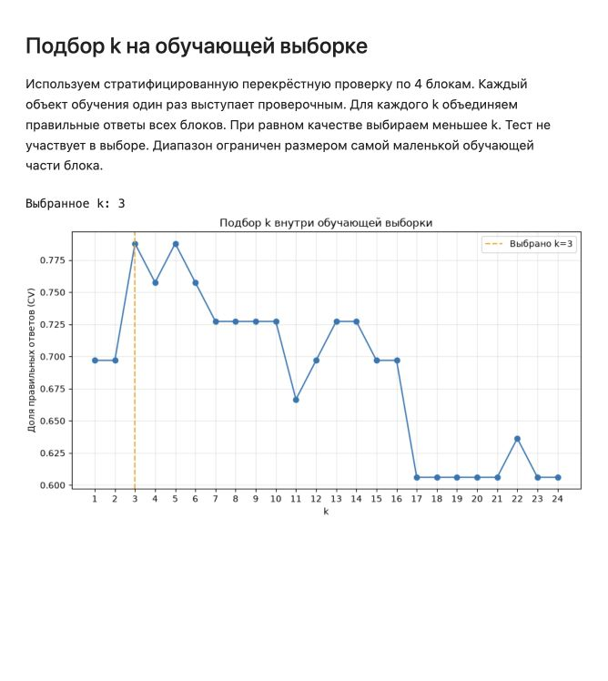
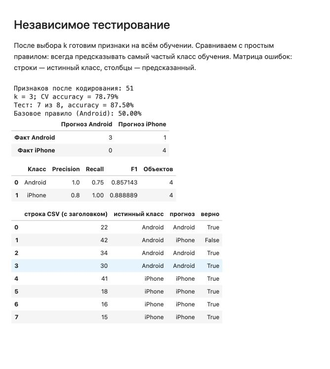
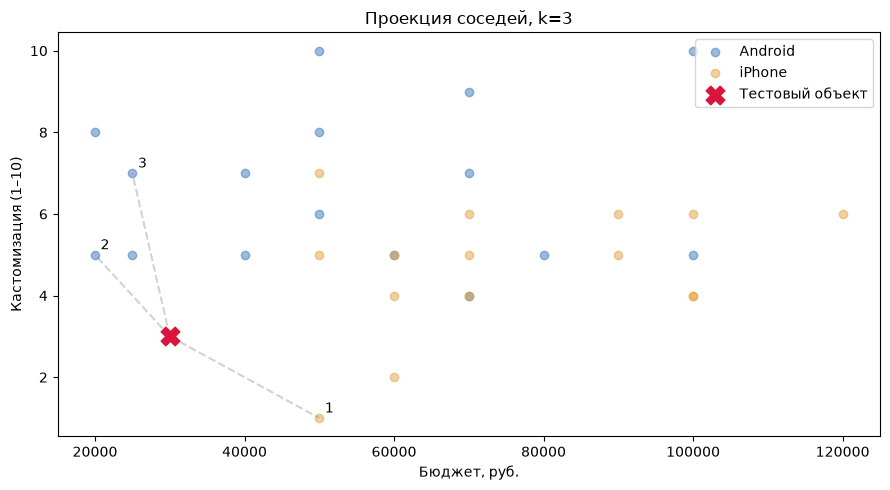

# Отчёт по практической работе №1

**Дисциплина:** «Интеллектуальные системы и технологии»
**Тема:** классификация пользователей iPhone и Android методом k ближайших соседей
**Год:** 2026

## 1. Цель и постановка задачи

Цель работы — реализовать метод k ближайших соседей, подготовить данные анкеты, проверить качество классификации и определить подходящее количество соседей.

По условиям задания необходимо спрогнозировать разновидность телефона пользователя — iPhone или Android. В качестве исходных данных используется предоставленный CSV с ответами на анкету. Ответ на вопрос 22 «У Вас айфон или андроид?» является целевой переменной. Поэтому модель прогнозирует **текущий тип телефона**, а не абстрактное предпочтение или будущую покупку.

Работа включает подготовку данных, собственную реализацию классификатора, тестирование, анализ параметра k, визуализацию решения и обсуждение результата.

## 2. Описание датасета

В файле `data/phone_preferences.csv` содержится **41 анкета и 23 столбца**: время заполнения и ответы на 22 вопроса. Пустых ответов нет. Повторов полных анкет без учёта времени нет.

| Класс | Код | Количество | Доля |
|---|---:|---:|---:|
| Android | 0 | 22 | 53,66% |
| iPhone | 1 | 19 | 46,34% |
| Всего | — | 41 | 100% |

Для классификации используются 21 вопрос. Время заполнения удаляется, а вопрос 22 отделяется от признаков.

| Вопросы | Содержание | Представление |
|---|---|---|
| 7, 8, 9, 13, 18, 21 | Возраст, бюджет, важность кастомизации, срок смены телефона, число зарядок, частота употребления яблок | Числовые признаки |
| 4 | Причины переплаты: статус, камера, экосистема, надёжность | Четыре бинарных индикатора |
| 1, 2, 3, 5, 6, 10, 11, 12, 14, 15, 16, 17, 19, 20 | Остальные ответы, включая привычки, деятельность и предпочтения | Категориальные признаки |

Вопрос про яблоки сохранён как часть исходной анкеты. Его наличие не означает доказанной связи с выбором телефона. После кодирования обучающей выборки получен **51 числовой признак**.



*Рисунок 1 — распределение ответов по типу телефона. График получен при выполнении ноутбука.*

## 3. Подготовка данных

### 3.1. Очистка ответов

Из строк удалены лишние пробелы, категориальные ответы приведены к нижнему регистру. Варианты IT, ИТ, «программист», «программирование», «разработка», «тех под» и «корпоративные системы» объединены в категорию IT. Остальные названия деятельности сохранены.

Для бюджета приняты следующие правила:

- `100.000` и `90.000` рассматриваются как 100 000 и 90 000 рублей;
- значения от 10 до 999 считаются тысячами рублей: например, `60` преобразуется в 60 000;
- бюджет меньше 10 и возраст вне диапазона 14–100 заменяются пропусками.

Правило о тысячах — **допущение**: единицы коротких ответов явно не указаны. В последней анкете возраст `5` и бюджет `3` признаны сомнительными. Анкета сохраняется, а эти два значения заполняются медианами соответствующей обучающей части. Иные ответы этой строки не исправляются автоматически. Эта анкета попала в тест и оказалась единственной ошибкой модели; качество данных здесь существенно влияет на оценку.

В вопросе с несколькими вариантами ответы разделяются по `;`. Служебная надпись «Мультивыбор» исключается.

### 3.2. Разделение выборки

Выполнено стратифицированное разделение примерно 80/20 с `seed = 42`. Из-за целочисленного округления получены 33 обучающих и 8 тестовых объектов.

| Класс | Обучение | Тест |
|---|---:|---:|
| Android | 18 | 4 |
| iPhone | 15 | 4 |
| Всего | 33 | 8 |



*Рисунок 2 — скриншот очищенных значений и разделения выборки из HTML-представления выполненных ячеек.*

### 3.3. Нормализация и кодирование

Для числовых признаков используется Z-нормализация:

$$z_j = \frac{x_j-\mu_j}{\sigma_j}.$$

Медианы, средние значения и стандартные отклонения вычисляются только на обучающей части. Если отклонение равно нулю, вместо него используется 1. Те же параметры применяются к проверочным объектам.

Категориальные ответы кодируются one-hot. Чтобы смена категории одного вопроса давала единичный вклад в квадрат евклидова расстояния, one-hot значения делятся на $\sqrt{2}$. Категории, которых не было на обучении, кодируются нулевым блоком. Четыре варианта мультивыбора — самостоятельные бинарные признаки.

При перекрёстной проверке вся подготовка заново обучается внутри каждого блока. Это исключает использование статистик проверочной и тестовой частей при подготовке обучения.

## 4. Реализация метода k ближайших соседей

Алгоритм реализован самостоятельно на NumPy. Готовые классификаторы sklearn не используются. Pandas применяется для таблиц, Matplotlib — для графиков.

Для проверяемого объекта вычисляется евклидово расстояние до каждого обучающего объекта:

$$d(x,z)=\sqrt{\sum_{j=1}^{m}(x_j-z_j)^2}.$$

Затем расстояния сортируются и выбираются k ближайших соседей. Используется взвешенное голосование:

$$w_i = \frac{1}{d_i+\varepsilon},\qquad \varepsilon=10^{-10}.$$

Суммарный вес класса:

$$S_c=\sum_{i=1}^{k} w_i\,[y_i=c],\qquad \hat y=\arg\max_c S_c.$$

Близкие соседи влияют сильнее дальних. Если расстояние не превышает $10^{-10}$, объект считается точным совпадением; при наличии совпадений голосуют только они с одинаковыми весами. При равенстве итоговых весов выбирается класс 0 — Android. Сортировка стабильная, поэтому результат воспроизводится и при равных расстояниях.

Проверяется ограничение $1\leq k\leq n_{train}$. Расстояния вычисляются сразу для всех проверяемых объектов; для теста получается матрица 8 × 33.



*Рисунок 3 — скриншот реализации расстояния и взвешенного голосования. Полный код доступен в ноутбуке.*

## 5. Подбор оптимального k

Значение k подбирается **только на 33 обучающих объектах** с помощью стратифицированной перекрёстной проверки по 4 блокам. Каждый обучающий объект один раз используется для проверки. Accuracy вычисляется по всем объединённым проверочным предсказаниям.

Перебираются значения **от 1 до 24**. Верхняя граница ограничена размером наименьшей обучающей части внутри блока: в отличие от большого датасета вина, здесь нельзя корректно проверять k = 30 во всех блоках.

| k | CV accuracy |
|---|---:|
| 1–2 | 69,70% |
| 3 | **78,79%** |
| 4 | 75,76% |
| 5 | **78,79%** |
| 6 | 75,76% |
| 7–10 | 72,73% |
| 11 | 66,67% |
| 12 | 69,70% |
| 13–14 | 72,73% |
| 15–16 | 69,70% |
| 17–21 | 60,61% |
| 22 | 63,64% |
| 23–24 | 60,61% |

Максимум одинаков для k = 3 и k = 5. По заранее заданному правилу выбирается меньшее значение — **k = 3**. Верно классифицированы 26 из 33 проверочных объектов. Тестовые ответы в этом выборе не участвуют.



*Рисунок 4 — скриншот процедуры выбора k и графика качества на перекрёстной проверке.*

Малое k чувствительно к отдельным анкетам и шуму. При большом k в голосовании участвуют далёкие объекты, а результат сильнее зависит от частоты классов. На данной выборке после k = 5 качество в целом снижается, хотя зависимость не монотонна.

## 6. Независимое тестирование

После выбора k = 3 подготовка признаков обучается на всех 33 обучающих анкетах. Затем один раз оценивается тест из 8 анкет.

$$Accuracy=\frac{\text{число верных ответов}}{\text{число тестовых объектов}}=\frac{7}{8}=87{,}5\%.$$

Для сравнения используется базовое правило: всегда предсказывать самый частый класс обучения, Android. Оно даёт 4 правильных ответа из 8, то есть 50%.

Матрица ошибок: строки соответствуют истинным классам, столбцы — прогнозам.

| Истинный класс | Прогноз Android | Прогноз iPhone |
|---|---:|---:|
| Android | 3 | 1 |
| iPhone | 0 | 4 |

| Класс | Precision | Recall | F1 | Число объектов |
|---|---:|---:|---:|---:|
| Android | 1,0000 | 0,7500 | 0,8571 | 4 |
| iPhone | 0,8000 | 1,0000 | 0,8889 | 4 |

Precision — доля правильных прогнозов среди прогнозов данного класса, Recall — доля найденных объектов класса, F1 — гармоническое среднее Precision и Recall.



*Рисунок 5 — скриншот результатов запуска: accuracy, базовый прогноз, матрица ошибок, метрики и ответы по всем тестовым анкетам.*

Проверки для точного совпадения, ближайшего соседа и недопустимого k прошли. Все ячейки ноутбука выполнены последовательно без ошибок. Дополнительно проверен запуск через `python run.py`, формирующий выполненный ноутбук и HTML.

## 7. Демонстрация решения для отдельной анкеты

Для демонстрации взят первый тестовый объект без подбора удобного примера: строка 22 исходного CSV при нумерации с заголовком. Его истинный класс — Android. Для выбранного k = 3 найдены следующие соседи:

| Место | Строка CSV | Класс | Расстояние | Вес |
|---|---:|---|---:|---:|
| 1 | 5 | iPhone | 2,279349 | 0,438722 |
| 2 | 26 | Android | 2,425482 | 0,412289 |
| 3 | 19 | Android | 2,868052 | 0,348669 |

Суммарный вес Android равен примерно 0,760958; вес iPhone — 0,438722. Поэтому прогноз — **Android**, он совпадает с истинным ответом. Хотя самый близкий сосед относится к iPhone, два других соседа перевешивают его голос.



*Рисунок 6 — проекция на бюджет и важность кастомизации. Красным крестом отмечен тестовый объект, цифрами — его соседи. Расстояния рассчитаны по всем 51 признакам, а не только по двум осям графика.*

## 8. Соответствие заданию и проверка кода

| Пункт задания | Реализация |
|---|---|
| Подготовка исходных данных | Очистка ответов, обработка бюджета, заполнение пропусков, кодирование и нормализация |
| Метод k ближайших соседей | Собственная реализация расстояния и взвешенного голосования |
| Тестирование | Независимый тест, базовый прогноз, матрица ошибок и метрики |
| Анализ «какое k лучше?» | Перебор 1–24 по 4 блокам, выбор k = 3 |
| Показ решения | Выполненный ноутбук, HTML и рисунки в отчёте |
| Обсуждение | Сравнение с базовым правилом и ограничения ниже |

Командные пункты — распределение ролей, парное программирование и code review другой бригадой — требуют реальной работы участников. Их проведение не заявляется. Материалы для демонстрации и взаимной проверки подготовлены.

Для рецензирования другой командой следует проверить: исключение целевого столбца из признаков, вычисление статистик только на обучении, ограничение k, обработку нулевых расстояний, отсутствие подбора k по тесту и воспроизводимость запуска. Эти технические условия проверены при подготовке решения; это не заменяет рецензию другой бригады.

## 9. Выводы

Реализован взвешенный метод k ближайших соседей для классификации пользователей iPhone и Android. Подготовлены числовые, категориальные признаки и множественный выбор. На перекрёстной проверке наилучший результат получен при k = 3 и k = 5; по правилу выбора меньшего k использовано **k = 3**.

На независимом тесте получено **87,5% (7 из 8)** против **50%** у базового прогноза. Для данного разделения k-NN справился лучше постоянного ответа Android. Статистическое превосходство и универсальность модели этим экспериментом не доказаны.

Выборка мала и в основном состоит из респондентов близкого возраста. Один ответ меняет тестовую accuracy на 12,5 процентного пункта. Ошибка пришлась на анкету с сомнительными исходными значениями. Нужно уточнить единицы бюджета, проверить качество анкет и собрать больше данных. Связи между ответами и телефоном являются статистическими ассоциациями, а не доказанными причинами выбора.

## 10. Как запустить

Требуется Python 3.11 или новее. Из корня репозитория:

```bash
cd pr1
python3 -m venv .venv
source .venv/bin/activate
python -m pip install -r requirements.txt
python run.py
```

В Windows вместо `source` используется `.venv\Scripts\activate`.

Скрипт выполняет все ячейки в ядре того же Python, сохраняет результаты в `Practice_1.ipynb` и формирует `Practice_1.html`. HTML можно открыть в браузере без Jupyter. Чтобы работать интерактивно:

```bash
python -m notebook Practice_1.ipynb
```

В Jupyter выбрать **Run → Run All Cells**. Исходный CSV должен оставаться в папке `data` рядом с ноутбуком. Скриншоты в `images` фиксируют проверенный запуск; скрипт повторно формирует ноутбук и HTML, а не переснимает браузер автоматически.
